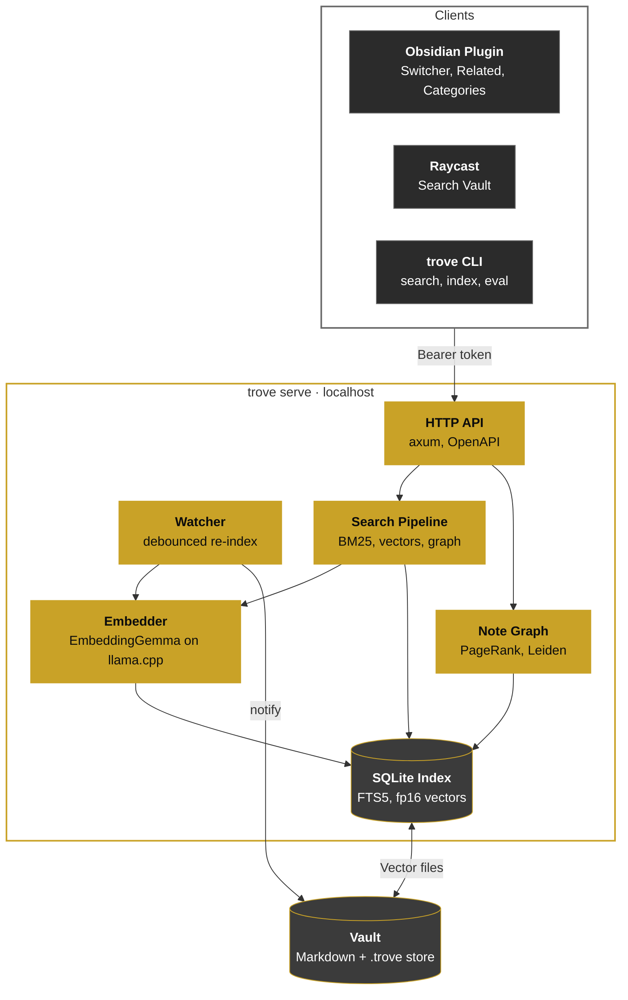

<div align="center">

<h1>Trove</h1>

<b>Local semantic search for your notes.</b>

Search an Obsidian vault by meaning, see related notes and get link suggestions. Everything runs on your machine with a local embedding model.

<br />

[](https://github.com/marioparaschiv/trove/releases)
[](https://github.com/marioparaschiv/trove/actions/workflows/ci.yml)
[](https://www.rust-lang.org)
[](https://github.com/ggml-org/llama.cpp)
[](./LICENSE)

[Install](#installation) · [Usage](#usage) · [Architecture](#architecture)

</div>

## Contents

- **For Users:** [What Is Trove?](#what-is-trove) · [Features](#features) · [Installation](#installation) · [Usage](#usage) · [Configuration](#configuration)
- **For Developers:** [Building Trove](#building-trove) · [Architecture](#architecture) · [Search Pipeline](#search-pipeline) · [Evaluation](#evaluation)
- **Project:** [Contributing](#contributing) · [License](#license)

## For Users

### What Is Trove?

Trove indexes folders of Markdown notes and searches them by words and by meaning. The query "how to keep my bread culture alive" finds a note called `Sourdough starter`, though they share no words.

It is a single Rust binary that embeds notes with [EmbeddingGemma](https://huggingface.co/ggml-org/embeddinggemma-2-GGUF) on [llama.cpp](https://github.com/ggml-org/llama.cpp). It needs no API key and sends nothing anywhere. Your notes stay on your machine.

Trove also builds a graph from your links, tags and similar sections. It uses that graph to rank results, find related notes and group the vault into categories. You reach it from Obsidian, Raycast, the CLI or a local HTTP API.

### Features

| Feature          | Description                                                                                  |
| ---------------- | -------------------------------------------------------------------------------------------- |
| Hybrid search    | Vector and BM25 full-text search, scored together and reranked over the note graph.          |
| Typo tolerance   | A misspelt word finds its closest indexed word. Chinese, Japanese and Thai match mid-text.   |
| Related notes    | A panel under each note, ranked by personalised PageRank over links and meaning.             |
| Link suggestions | Notes close in meaning with no link between them. Accept one and Trove adds the link.        |
| Categories       | Hierarchical Leiden communities, each named by its most distinctive terms.                   |
| Live indexing    | A file watcher re-indexes changed notes at low priority. Only new chunk texts get embedded.  |
| Synced vectors   | Vectors sync with the vault, so a second device builds its index without running the model. |
| Low footprint    | The model loads on demand and unloads after 3 idle minutes. The service exits after 15.      |

### Installation

Releases cover Linux x86_64, macOS arm64 and Windows x86_64. The model runs on a discrete GPU when there is one: Metal on macOS, Vulkan elsewhere. Otherwise it runs on the CPU, and builds ship every CPU variant so the best one loads at run time.

**Obsidian (recommended)**

1. Download `main.js` and `manifest.json` from the [latest release](https://github.com/marioparaschiv/trove/releases/latest).
2. Put them in `<vault>/.obsidian/plugins/trove/` and enable Trove under Community plugins.
3. On first run the plugin downloads the matching `trove` binary and checks its SHA-256. It then downloads the model (310 MB) and indexes the vault.

**CLI**

Download the archive for your platform from the [latest release](https://github.com/marioparaschiv/trove/releases/latest). Unpack it and keep the libraries next to the binary.

```bash
trove setup                      # download and verify the model
trove sources add ~/Notes        # register a folder
trove index                      # index it
```

**Raycast** (macOS, Windows): build the extension in [`clients/raycast`](clients/raycast) and set its `Trove Binary` preference to the `trove` executable.

### Usage

In Obsidian:

| Command                 | What it does                                                               |
| ----------------------- | -------------------------------------------------------------------------- |
| Open quick switcher     | `Ctrl+O` with Trove's results merged in. Opens at the matched heading.     |
| Review link suggestions | Steps through suggested links one at a time. Link or dismiss each.         |
| Preview categories      | Lists what applying categories would change. Changes nothing.              |
| Apply categories        | Writes `category` and `parent` properties and one note per category.       |
| Merge category into...  | Pins a manual edit that overrides the computed categories on every device. |

Related notes show under every note. Each note's category path shows above its title.

From the terminal:

```bash
trove search "waiting longer between failed requests"
trove search "tomato leaves going brown" --limit 5 --json
trove categories                 # the vault grouped into categories
trove status                     # model state and index size
trove serve                      # run the HTTP API on localhost
```

### Configuration

Settings live in `config.toml` in Trove's data folder: the OS's local data folder, or `TROVE_DATA_DIR` when set. Every field is optional. The defaults:

```toml
model_idle_timeout = "3m"
service_idle_timeout = "15m"
index_debounce = "30s"
store_folder = ".trove"
```

## For Developers

### Building Trove

Requirements: Rust 1.97, CMake, a C++ compiler and, on Linux and Windows, the Vulkan SDK (`VULKAN_SDK`). The build fetches llama.cpp at a pinned commit, patches it and compiles it.

```bash
git clone https://github.com/marioparaschiv/trove
cd trove
cargo build --release
cargo test
```

The tests run the real model against fixture vaults, so run `trove setup` once first. The clients are a Bun workspace in [`clients`](clients).

### Architecture

`trove serve` is a local HTTP service that clients start on demand. It writes a runtime file with its port and a bearer token, so clients can find it and other programs can't call it. A `Host` check blocks DNS rebinding from web pages.



- **Chunking.** One chunk per heading section. A long section splits at paragraph boundaries to fit a 2048-token context. Identical texts embed once.
- **Vector versioning.** `vector_version` hashes the model file, the llama.cpp tag, the prompts and the chunker version. Vectors from different setups never mix.
- **llama.cpp.** Built from source at a pinned tag, with a patch that skips logits for embedding models. That saves 1 MiB per token with Gemma's 262k vocabulary.
- **GPU choice.** Integrated Vulkan GPUs are skipped: on a Ryzen iGPU the same text embedded twice drifted to cosine 0.92, and indexed slower than the CPU.
- **Background work.** Indexing the service starts on its own uses fewer threads at below-normal priority. Searches run at full speed.
- **Model download.** Resumes after a dropped connection, retries with backoff and verifies the SHA-256.
- **Sync store.** Each source has a `.trove` folder with one fp16 vector file per note. Syncthing or Dropbox carries it to other devices, which import the vectors instead of embedding again. Sync conflict copies get cleaned up.
- **Crash safety.** Files are written to a temporary file and renamed. A lock allows one service per data folder, and the OS releases it if the process dies.

| Crate                                      | What it is                                                             |
| ------------------------------------------ | ---------------------------------------------------------------------- |
| [`crates/trove`](crates/trove)             | The `trove` binary: the CLI and the client for a running service.      |
| [`crates/trove-core`](crates/trove-core)   | Indexing, search, the graph, categories, suggestions and the HTTP API. |
| [`crates/trove-llama`](crates/trove-llama) | Safe Rust bindings to llama.cpp, and the build that compiles it.       |

| Client                                   | What it is                                                |
| ---------------------------------------- | --------------------------------------------------------- |
| [`clients/obsidian`](clients/obsidian)   | The Obsidian plugin.                                      |
| [`clients/raycast`](clients/raycast)     | The Raycast extension.                                    |
| [`clients/ts-client`](clients/ts-client) | A typed TypeScript client generated from `trove openapi`. |

### Search Pipeline

Search runs as a pipeline of stages. A request can turn any stage off, to measure what it adds.

1. **Meaning.** Cosine similarity to every chunk, turned into z-scores for this query. Only chunks that clearly stand out match, so a query on a topic the vault lacks returns nothing. Short queries are expanded towards the chunks they find best.
2. **Words.** SQLite FTS5 with BM25 and Porter stemming over each chunk's title, heading path and text. A word that matches nothing falls back to a trigram table, for typos and for Chinese, Japanese and Thai.
3. **Scoring.** Each note is scored from its meaning z-score, its weighted share of the query's words, and a bonus for a second section that also stands out. Lookups such as `TRV-8812` weight exact words higher.
4. **Graph rerank.** Personalised PageRank, seeded by the candidates, blends each note's graph rank into its score. It can also add linked notes that matched nothing directly.
5. **Collapse.** One result per note, pointing at its best heading and listing the stages that found it.

The graph joins notes to their sections, links (wikilinks, Markdown links, heading and block links), tags, and sections with cosine similarity of 0.75 or more. Related notes and categories walk the same graph.

### Evaluation

Every ranking weight and threshold was set by measurement. The eval set is a 300-note vault with 150 queries: paraphrases, lookups, questions, vague queries, typos and queries with no answer, in English, German, Japanese, Chinese and Spanish. `trove eval` reports recall@1, recall@10 and MRR, and `--fit` fits the weights on two thirds of the queries and scores them on the rest:

```bash
trove sources add crates/trove/tests/fixtures/eval-vault
trove index
trove eval crates/trove/tests/fixtures/eval-queries.json
trove eval crates/trove/tests/fixtures/eval-queries.json --fit
```

CI runs Clippy with warnings denied and the full test suite, real model included, on Linux, macOS and Windows.

## Project

### Contributing

Contributions are welcome. Before opening a PR:

1. Run `cargo clippy --all-targets -- --deny warnings` and `cargo test`. CI enforces both.
2. If you changed a client, run its `lint`, `typecheck` and `test` scripts from [`clients`](clients).
3. If a change affects chunk texts or boundaries, bump the chunker's `VERSION` so old vectors get rebuilt.

### License

Trove is licensed under the [MIT License](./LICENSE).
